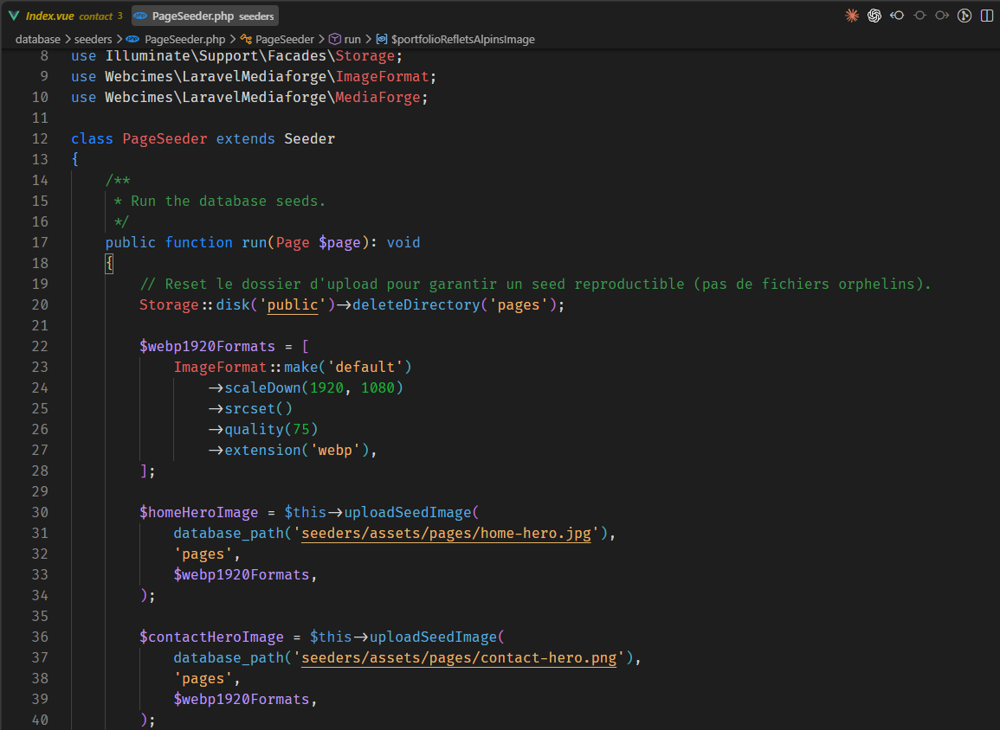

# Webcimes Dark Theme

<p align="center">
  
</p>

Webcimes Dark Theme provides a focused, carefully balanced dark workspace for Visual Studio Code.

[View on the Visual Studio Marketplace](https://marketplace.visualstudio.com/items?itemName=webcimes.webcimes-dark-theme)

It includes:

- refined syntax colors for PHP, JavaScript, Vue, HTML, and CSS;
- custom bracket-pair and inlay-hint colors;
- a discreet status bar designed to blend with the Modern UI shell;
- compatibility with VS Code Modern UI.

## Preview

### Vue


### PHP



## Recommended setting

Modern UI is optional, but the theme has been tuned to work with it:

```json
"workbench.experimental.modernUI": true
```

## License

[Source code](https://github.com/WebCimes/webcimes-dark-theme) · [Report an issue](https://github.com/WebCimes/webcimes-dark-theme/issues)

MIT © WebCimes
