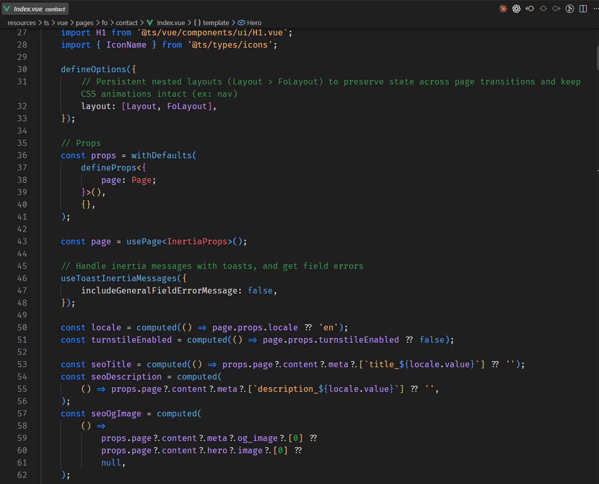

# Webcimes Dark Theme

<p align="center">
  
</p>

Webcimes Dark Theme provides a focused, carefully balanced dark workspace for Visual Studio Code.

[View on the Visual Studio Marketplace](https://marketplace.visualstudio.com/items?itemName=webcimes.webcimes-dark-theme)

It includes:

- refined syntax colors for PHP, JavaScript, Vue, HTML, and CSS;
- custom bracket-pair and inlay-hint colors;
- a discreet status bar designed to blend with the Modern UI shell;
- compatibility with VS Code Modern UI.

[Browse the preview](https://webcimes.github.io/webcimes-dark-theme/)

## Preview

### Vue



### PHP


## Recommended setting

Modern UI is optional, but the theme has been tuned to work with it:

```json
"workbench.experimental.modernUI": true
```

## Other WebCimes projects

- [WebCimes Modal](https://github.com/WebCimes/webcimes-modal) — Modals and confirmations
- [WebCimes Cookies](https://github.com/WebCimes/webcimes-cookies) — Cookie consent
- [WebCimes Select](https://github.com/WebCimes/webcimes-select) — Searchable select fields
- [WebCimes Tooltip](https://github.com/WebCimes/webcimes-tooltip) — Tooltips and popovers
- [Laravel MediaForge](https://github.com/WebCimes/laravel-mediaforge) — File and image processing

## License

[Source code](https://github.com/WebCimes/webcimes-dark-theme) · [Report an issue](https://github.com/WebCimes/webcimes-dark-theme/issues)

MIT © WebCimes

## Local development

Use Node.js 22 or later and run `npm ci`. Run `make dev` to serve the preview with Python 3, or `make pack` to create an installable VSIX.

For a new Marketplace release, update the version in `package.json` and refresh `package-lock.json`. Commit the release changes on `main`, then run `make release` to package the VSIX, push `main`, publish the archive to the Marketplace, and push the version tag.
